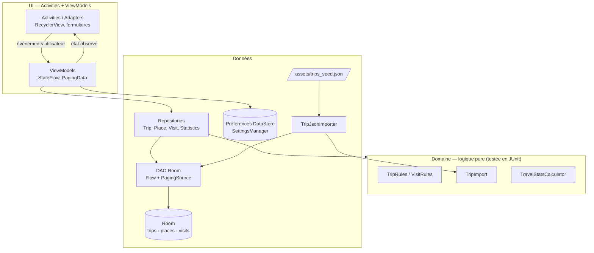
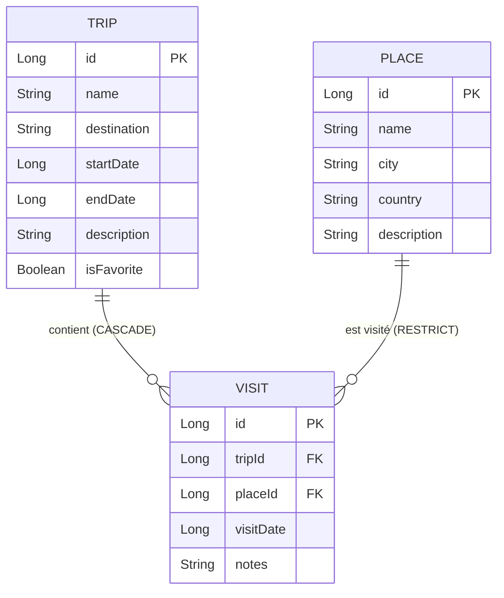

# TripJournal — Carnet de voyage Android

Application Android native (Kotlin) pour organiser ses voyages : créer des voyages, enregistrer des lieux,
planifier des visites jour par jour et consulter des statistiques de voyage.

Projet de fin de cours : UI Android, navigation, Room, architecture MVVM, Flow, Paging 3, DataStore,
import JSON, débogage et tests automatisés.

---

## Sommaire

1. [Fonctionnalités](#fonctionnalités)
2. [Architecture](#architecture)
3. [Modèle de données (Room)](#modèle-de-données-room)
4. [Installation et lancement](#installation-et-lancement)
5. [Tests](#tests)
6. [Débogage : bugs documentés](#débogage--bugs-documentés)
7. [Contributions de l'équipe](#contributions-de-léquipe)

---

## Fonctionnalités

### Écrans

| Écran | Rôle |
|---|---|
| **Menu principal** (`MainActivity`) | Point d'entrée vers tous les écrans, lance l'import JSON initial |
| **Mes voyages** (`TripListActivity`) | Liste des voyages, ajout via le bouton + |
| **Formulaire voyage** (`TripFormActivity`) | Création / modification / suppression, validation des champs et des dates |
| **Détail du voyage** (`TripDetailActivity`) | Itinéraire regroupé par jour (Jour 1, Jour 2…) |
| **Formulaire visite** (`VisitFormActivity`) | Associer un lieu à un voyage, à une date comprise dans le voyage, avec des notes |
| **Mes lieux** (`PlaceListActivity`) + **formulaire lieu** (`PlaceFormActivity`) | CRUD des lieux |
| **Catalogue** (`CatalogActivity`) | Catalogue principal en **Paging 3** : recherche, tri, états vide / erreur / chargement |
| **Statistiques** (`StatisticsActivity`) | Statistiques calculées en direct depuis la base |
| **Réglages** (`SettingsActivity`) | Préférences **DataStore** et réinitialisation des données |

### Exigences couvertes

| Exigence | Implémentation |
|---|---|
| ≥ 5 écrans, navigation | 10 écrans, menu principal |
| RecyclerView | Listes des voyages, lieux, itinéraire, catalogue (`PagingDataAdapter`) |
| Formulaires validés | `TripRules`, `VisitRules` : champs obligatoires, fin ≥ début, visite dans les dates du voyage, doublons refusés |
| États vides / erreurs | Messages vides sur chaque liste, état d'erreur + « Réessayer » dans le catalogue, Snackbars |
| Rotation | État dans les ViewModels, champs non réinitialisés, sélecteurs de date rebranchés |
| 3 entités Room + relations | `Trip`, `Place`, `Visit` (voir ci-dessous) |
| ≥ 2 CRUD complets | Voyages, lieux, visites |
| DAO + Repository + ViewModel | Couche `data/` + `ui/*ViewModel` |
| Flow | Tous les DAO de lecture renvoient des `Flow`, les écrans se mettent à jour seuls |
| Paging 3 | `TripDao.getTripsPaged*` → `Pager` dans `TripRepository` → `CatalogViewModel` (`cachedIn`) |
| Recherche / filtre / tri | Catalogue : recherche nom ou destination + 4 tris |
| JSON initial | `assets/trips_seed.json` (25 entrées : 22 valides, 2 invalides, 1 doublon volontaires) |
| Préférences DataStore | 4 préférences (voir ci-dessous) |

### Préférences (Preferences DataStore)

| Préférence | Effet visible |
|---|---|
| **Thème** (système / clair / sombre) | Appliqué immédiatement à toute l'application, conservé au redémarrage |
| **Tri par défaut** | Tri initial du catalogue ; mis à jour en direct si on le change |
| **Confirmer la suppression** | Active ou non le dialogue de confirmation avant de supprimer un voyage, un lieu ou une visite |
| **Unité de distance** | Enregistrée (prévue pour l'affichage des distances) |

Toutes sont exposées en `Flow` par `SettingsManager` : aucun rafraîchissement manuel n'est nécessaire.

### Fonctionnalités métier

1. **Itinéraire par jour** — les visites d'un voyage sont regroupées et numérotées par jour
   (`VisitRules.buildItinerary`) ; une visite ne peut pas tomber hors des dates du voyage, et les visites
   devenues incohérentes après modification d'un voyage sont signalées.
2. **Statistiques de voyage** — `TravelStatsCalculator` calcule le total de jours de voyage, le plus long
   voyage, le statut (en cours / à venir / terminés), le top 3 des pays et le lieu le plus visité. Les
   statistiques sont recalculées automatiquement à chaque modification (`combine` des Flow des 3 tables).
3. **Cohérence des données** — supprimer un voyage supprime ses visites (`CASCADE`) ; un lieu utilisé
   par une visite ne peut pas être supprimé (`RESTRICT` + message explicite).

### Import JSON initial

- Fichier : `app/src/main/assets/trips_seed.json`.
- Chaque enregistrement est **validé** avant insertion (`TripImport.prepare`) : dates au format
  `yyyy-MM-dd`, champs obligatoires, fin ≥ début.
- **Doublons ignorés** (même nom, sans tenir compte des majuscules, et même jour de départ — `TripRules.isDuplicate`),
  dans le fichier comme en base.
- **Exécuté une seule fois** (marqueur persistant) : les modifications de l'utilisateur ne sont jamais
  écrasées. Le bouton « Réinitialiser » des Réglages permet de repartir des données d'origine.

---

## Architecture

Architecture **MVVM** en couches : l'interface n'accède jamais directement à la base.



### Organisation du code

```
com.example.tripjournal
├── MainActivity, TripJournalApplication   menu principal, thème appliqué au démarrage
├── data
│   ├── database        TripJournalDatabase, entity/ (Trip, Place, Visit), dao/
│   ├── repository      TripRepository, PlaceRepository, VisitRepository, StatisticsRepository
│   ├── importer        TripJsonImporter (import JSON unique)
│   └── settings        SettingsManager (Preferences DataStore)
├── domain              TripRules, VisitRules, TripImport, TravelStats (logique pure)
└── ui
    ├── trips           liste, détail/itinéraire, formulaires voyage et visite
    ├── places          liste et formulaire des lieux
    ├── catalog         catalogue Paging 3
    ├── statistics      écran des statistiques
    └── settings        écran des réglages
```

---

## Modèle de données (Room)



`Visit` est l'entité d'association entre `Trip` et `Place` (relation plusieurs-à-plusieurs).
`VisitWithPlace` (`@Embedded` + `@Relation`) charge une visite avec son lieu pour l'itinéraire.

---

## Installation et lancement

**Prérequis** : Android Studio récent (AGP 9.5), **JDK 25** (à choisir comme « Gradle JDK » dans les réglages d'Android Studio), un émulateur ou appareil Android 8.0+ (API 26).

1. Cloner le dépôt puis l'ouvrir dans Android Studio (*File → Open*).
2. Laisser la synchronisation Gradle se terminer.
3. Lancer la configuration **app** sur un émulateur.

En ligne de commande :

```bash
./gradlew :app:installDebug
```

Au premier lancement, les 22 voyages du JSON sont importés (Snackbar de confirmation).

---

## Tests

```bash
./gradlew :app:testDebugUnitTest            # tests JUnit (sans émulateur)
./gradlew :app:connectedDebugAndroidTest    # tests Espresso (émulateur démarré)
```

Ou dans Android Studio : clic droit sur `app/src/test` ou `app/src/androidTest` → *Run Tests*.

### JUnit — `app/src/test`

| Classe | Ce qui est vérifié |
|---|---|
| `VisitRulesTest` (6) | Visite dans / hors des dates du voyage, numéro de jour, itinéraire groupé et trié, validation d'un lieu |
| `TripImportTest` (3) | Validation des enregistrements JSON, rejet des invalides, détection des doublons |
| `TravelStatsCalculatorTest` (7) | Journal vide, durées, plus long voyage, statut par rapport à aujourd'hui, pays, top 3, moyenne et lieu le plus visité |

### Espresso — `app/src/androidTest`

| Classe | Ce qui est vérifié |
|---|---|
| `PlaceScreensTest` | Formulaire vide → message d'erreur ; un lieu ajouté apparaît dans la liste |
| `MainNavigationTest` | Le menu ouvre les Statistiques (avec les données importées) et les Réglages |
| `DeleteConfirmationTest` | Préférence DataStore « Confirmer la suppression » : activée → dialogue et rien n'est supprimé ; désactivée → suppression immédiate |

---

## Débogage : bugs documentés

### Bug 1 — Statistiques incomplètes pendant l'import initial

- **Symptôme** : juste après la première installation, l'écran Statistiques affichait **11 voyages**
  au lieu de 22, puis le bon chiffre quelques instants plus tard.
- **Diagnostic** : Logcat (`TripJsonImporter: Import : 22 ajoutés…`) confirmait 22 insertions. L'écran
  observe la table via un `Flow` Room, qui émet à **chaque** écriture : il affichait donc l'état
  intermédiaire, car l'import insérait les voyages **un par un** (22 transactions).
- **Correction** : insertion groupée `TripDao.insertTrips(list)` en **une seule transaction** ; les écrans
  voient les 22 voyages arriver d'un coup.

### Bug 2 — Risque de double import (concurrence)

- **Symptôme possible** : 44 voyages au lieu de 22 (chaque voyage en double).
- **Cause** : l'import est lancé depuis le menu principal **et** depuis la liste des voyages. Si les deux
  s'exécutent en même temps, chacun lit le marqueur « pas encore importé » et une base vide, puis insère
  tous les voyages. Le marqueur n'est écrit qu'à la fin : trop tard pour le second appel.
- **Correction** : un `Mutex` partagé (`companion object`) dans `TripJsonImporter` : un seul import à la
  fois ; le second appel attend, voit le marqueur et ne fait rien. Le marqueur est écrit avec `commit()`
  (synchrone) au lieu de `apply()`.

---

## Contributions de l'équipe

> Basé sur l'historique Git — chaque membre complète ou corrige sa ligne.

| Membre | Branche | Contributions |
|---|---|---|
| **Irina** | `feature/trips-database-irina` | Base Room `TripJournalDatabase`, `TripDao` |
| **Yazid** | `feature/places-visits-yazid` | Places/Visits : DAO, repositories, règles métier et tests JUnit ; écrans lieux (CRUD) ; détail du voyage et itinéraire par jour ; formulaire de visite ; repository, validation, liste et formulaire des voyages ; import JSON initial et ses tests ; tests Espresso des lieux |
| **Aymeric** | `feature/catalog-stats-aymeric` | Initialisation du projet, squelette Catalogue / Statistiques, revue et fusion des Pull Requests |
| **Fabrice** | `feature/settings-integration-fabrice` | Réglages en Preferences DataStore (thème, tri, confirmation de suppression, unité) ; catalogue Paging 3 avec recherche et tri ; écran Statistiques et `TravelStatsCalculator` + tests JUnit ; menu principal ; tests Espresso de navigation ; correction des bugs d'import ; intégration et README |
