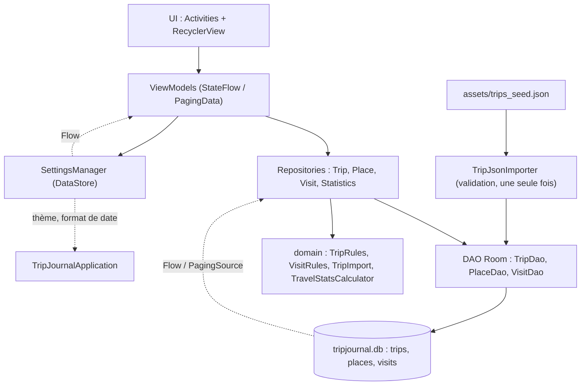
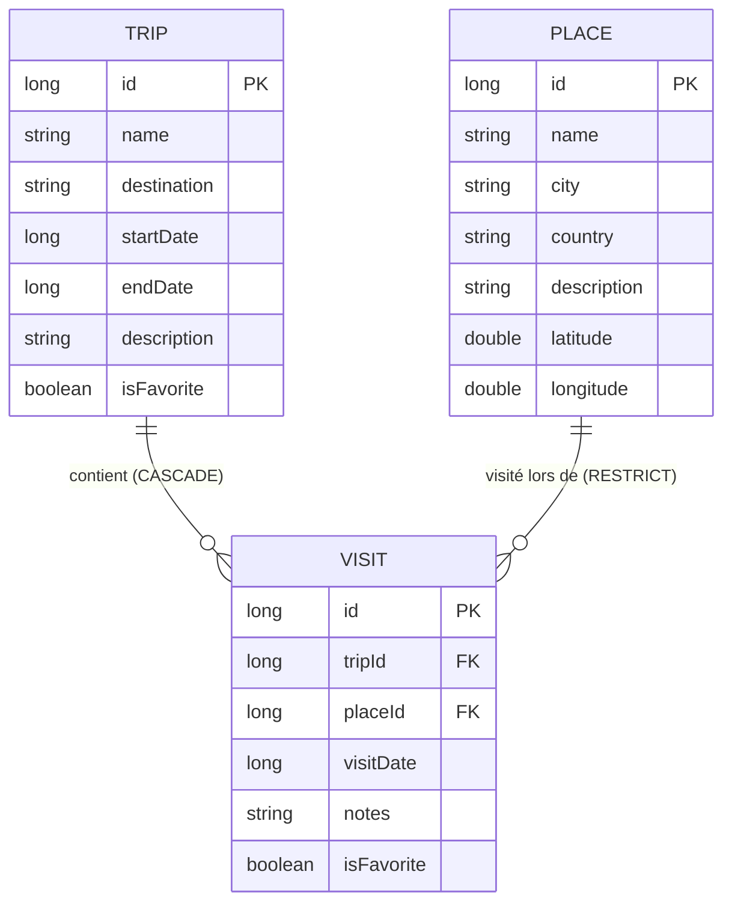

# TripJournal — Travel Diary

Application Android (Kotlin) de journal de voyage : gérer ses voyages, enregistrer les lieux visités avec dates et notes, organiser un itinéraire jour par jour et consulter des statistiques de voyage.

Projet final du module **E5 — Mobile Apps Development** (ESTIAM), présenté le **26 novembre 2026**.

---

## Sommaire

1. [Fonctionnalités](#1-fonctionnalités)
2. [Architecture](#2-architecture)
3. [Modèle de données Room](#3-modèle-de-données-room)
4. [Import JSON initial](#4-import-json-initial)
5. [Préférences DataStore](#5-préférences-datastore)
6. [Installation et lancement](#6-installation-et-lancement)
7. [Tests](#7-tests)
8. [Débogage : bugs documentés](#8-débogage--bugs-documentés)
9. [Équipe et contributions](#9-équipe-et-contributions)
10. [Workflow Git](#10-workflow-git)

---

## 1. Fonctionnalités

### Écrans (10)

| Écran | Classe | Rôle |
| --- | --- | --- |
| Menu principal | `MainActivity` | Point d'entrée, lance l'import JSON initial, mène à tous les écrans |
| Mes voyages | `TripListActivity` | Liste des voyages, état vide |
| Formulaire voyage | `TripFormActivity` | Création / modification avec validation (dates, doublons) |
| Détail d'un voyage | `TripDetailActivity` | Itinéraire regroupé par jour (Jour 1, Jour 2…) |
| Formulaire visite | `VisitFormActivity` | Date et notes d'une visite, lieu associé |
| Mes lieux | `PlaceListActivity` | Liste des lieux |
| Formulaire lieu | `PlaceFormActivity` | Création / modification / suppression d'un lieu |
| Catalogue des voyages | `CatalogActivity` | Liste paginée (Paging 3), recherche et tri |
| Statistiques | `StatisticsActivity` | Indicateurs de voyage recalculés en direct |
| Réglages | `SettingsActivity` | Préférences DataStore, réinitialisation des données |

### Gestion des données (CRUD)

- **Voyages** : créer, lire, modifier, supprimer (la suppression d'un voyage supprime ses visites en cascade).
- **Lieux** : créer, lire, modifier, supprimer. Un lieu utilisé par au moins une visite ne peut pas être supprimé.
- **Visites** : créer, lire, modifier, supprimer, rattachées à un voyage et à un lieu.

### Recherche, tri et pagination

Le catalogue est paginé avec **Paging 3** (pages de 10). La recherche porte sur le nom et la destination et se met à jour à la frappe. Quatre tris sont proposés : date décroissante, date croissante, nom (A-Z), destination (A-Z). Le tri par défaut vient des réglages.

### Fonctionnalités métier

1. **Itinéraire et cohérence des dates** (`VisitRules`) : une visite doit tomber pendant le voyage (premier et dernier jour inclus). Les visites sont groupées par jour (« Jour N » = jour depuis le début du voyage) et triées chronologiquement. Après raccourcissement d'un voyage, les visites qui sortent des nouvelles dates sont détectées.
2. **Statistiques de voyage** (`TravelStatsCalculator`) : nombre de voyages, lieux et visites, moyenne de visites par voyage, total de jours de voyage, plus long voyage, voyages à venir / en cours / terminés / favoris, top 3 des pays, lieu le plus visité. Elles sont recalculées automatiquement à chaque modification des trois tables (`combine` de Flows).

### Interface et robustesse

États vides (voyages, catalogue, itinéraire, statistiques), état d'erreur avec bouton « Réessayer » dans le catalogue, validation des formulaires avec messages, conservation de l'état à la rotation (ViewModels, dates du formulaire voyage conservées), thème clair / sombre.

---

## 2. Architecture

Architecture **MVVM** en couches, avec un Repository entre les ViewModels et Room.



| Couche | Package | Contenu |
| --- | --- | --- |
| UI | `ui/` (`catalog`, `trips`, `places`, `settings`, `statistics`) | Activities, adapters, ViewModels |
| Domaine | `domain/` | Règles métier pures, testables sans Android |
| Données | `data/repository/` | `TripRepository`, `PlaceRepository`, `VisitRepository`, `StatisticsRepository` |
| Persistance | `data/database/` | Base Room, entités, DAO |
| Import | `data/importer/` | `TripJsonImporter` |
| Préférences | `data/settings/`, `data/preferences/` | DataStore |

---

## 3. Modèle de données Room

Trois entités. `Visit` relie un voyage à un lieu : un voyage contient plusieurs visites, un lieu peut être visité dans plusieurs voyages.



- Supprimer un **voyage** supprime ses visites (`CASCADE`).
- Supprimer un **lieu** utilisé est refusé (`RESTRICT`) ; le dépôt renvoie `PlaceDeleteResult.InUse`.
- `VisitWithPlace` (`@Embedded` + `@Relation`) alimente l'itinéraire et les statistiques.
- Les écrans observent la base avec des **Flow** ; le catalogue utilise un `PagingSource` Room (`room-paging`).

---

## 4. Import JSON initial

- Fichier : `app/src/main/assets/trips_seed.json`, **25 enregistrements**.
- **Validation avant insertion** (`TripImport.prepare`) : nom et destination non vides, dates au format `yyyy-MM-dd` valides, fin non antérieure au début.
- Résultat sur le fichier fourni : **22 voyages importés, 2 invalides, 1 doublon ignoré** (un Snackbar l'indique au premier lancement).
- **Une seule fois** : un indicateur `seed_imported` est stocké dans les SharedPreferences `trip_import` ; un `Mutex` empêche deux imports simultanés.
- **Sans doublon** : un voyage est un doublon si un autre a le même nom (sans tenir compte de la casse) et le même jour de départ, en base ou dans le fichier. Les modifications de l'utilisateur ne sont jamais écrasées.
- Les Réglages permettent de tout réinitialiser et de réimporter le fichier (avec confirmation).

---

## 5. Préférences DataStore

`SettingsManager` expose chaque préférence sous forme de `Flow` : les écrans se mettent à jour sans rafraîchissement manuel, et les valeurs sont conservées après redémarrage.

| Préférence | Effet visible |
| --- | --- |
| Thème (système / clair / sombre) | Appliqué en direct à toute l'application (`TripJournalApplication`) |
| Format de date (jj/mm/aaaa, mm/jj/aaaa, ISO) | Toutes les dates affichées changent immédiatement |
| Tri par défaut des voyages | Tri initial du catalogue |
| Confirmer la suppression | Active ou désactive la boîte de dialogue de confirmation |
| Unité de distance (km / miles) | Enregistrée et restituée dans les réglages |

---

## 6. Installation et lancement

**Prérequis :** Android Studio récent, JDK (la version demandée par `gradle/gradle-daemon-jvm.properties` est téléchargée automatiquement par Gradle), un émulateur ou un appareil Android 8.0+.

| Paramètre | Valeur |
| --- | --- |
| Package | `com.example.tripjournal` |
| minSdk / targetSdk / compileSdk | 26 / 37 / 37 |
| Plugin Android (AGP) | 9.5.3 |
| KSP | 2.3.6 |
| Room | 2.8.4 |
| Paging 3 | 3.3.6 |
| DataStore Preferences | 1.1.7 |
| UI | XML + Material Components |

```bash
git clone <URL-du-dépôt>
cd TripJournal
```

1. Ouvrir le dossier (celui qui contient `settings.gradle.kts`) dans Android Studio.
2. Attendre la synchronisation Gradle.
3. Choisir un émulateur ou un appareil, puis lancer la configuration **`app`**.

Au premier lancement, les voyages du fichier JSON sont importés automatiquement.

---

## 7. Tests

### Tests unitaires JUnit (18)

```powershell
.\gradlew.bat :app:testDebugUnitTest
```

Rapport : `app/build/reports/tests/testDebugUnitTest/index.html`

| Classe | Tests | Ce qui est vérifié |
| --- | --- | --- |
| `TravelStatsCalculatorTest` | 7 | Statistiques vides, durée des voyages, plus long voyage, voyages à venir / en cours / terminés, pays, lieu le plus visité |
| `VisitRulesTest` | 6 | Visites dans / hors du voyage, numéro de jour, itinéraire groupé par jour, voyage raccourci, validation d'un lieu |
| `TripImportTest` | 3 | Enregistrement valide, enregistrements invalides rejetés, doublons ignorés |
| `TripRulesTest` | 2 | Plage de dates, tri et affichage des dates en UTC |

### Tests UI Espresso (7)

Démarrer un émulateur, puis :

```powershell
.\gradlew.bat :app:connectedDebugAndroidTest
```

Rapport : `app/build/reports/androidTests/connected/debug/index.html`

| Classe | Tests | Scénario |
| --- | --- | --- |
| `MainNavigationTest` | 2 | Le menu ouvre les écrans Statistiques et Réglages |
| `SettingsNavigationTest` | 1 | Les réglages restent disponibles après recréation de l'écran |
| `PlaceScreensTest` | 2 | Message de validation du formulaire vide ; un lieu ajouté apparaît dans la liste |
| `DeleteConfirmationTest` | 2 | Suppression avec et sans boîte de confirmation selon la préférence |

---

## 8. Débogage : bugs documentés

Outils utilisés : Logcat (filtre `TripJsonImporter`, `SettingsManager`), points d'arrêt et inspection des variables. Le détail figure aussi dans [`docs/BUGS.md`](docs/BUGS.md).

### Bug 1 — Doublons à l'import JSON

- **Symptôme :** les voyages du fichier pouvaient être insérés en double au premier lancement.
- **Cause :** deux écrans pouvaient lancer l'import en même temps ; chacun voyait une base vide et insérait tous les voyages.
- **Solution :** l'import passe par `importIfNeeded()`, protégé par un `Mutex` partagé par toute l'application, et l'indicateur « import effectué » est enregistré après l'insertion.

### Bug 2 — Incompatibilité KSP / AGP au build

- **Symptôme :** Gradle échoue pendant la configuration des sources Kotlin, avant la compilation de l'application.
- **Cause :** versions de KSP et d'AGP incompatibles (AGP 9.5.1 avec KSP 2.0.21-1.0.28).
- **Solution :** montée de version vers AGP 9.5.3 et KSP 2.3.6, et reprise des options de compatibilité proposées dans la PR #1.

### Bug connu non corrigé — Modification d'un lieu inexistant

- **Symptôme :** enregistrer le formulaire en mode édition avec un identifiant absent de la base crée un nouveau lieu.
- **Cause :** `PlaceFormViewModel` laisse `_place` à `null` quand le chargement échoue, puis construit un `Place` d'identifiant `0`, inséré comme nouveau lieu.
- **Correction prévue :** émettre un événement « lieu introuvable » et désactiver l'enregistrement quand le chargement échoue.

---

## 9. Équipe et contributions

| Membre | Branche | Contribution |
| --- | --- | --- |
| Aymeric | `feature/catalog-stats-aymeric` | Catalogue et statistiques de voyage |
| Global | `feature/launcher-trip-list` | Écran de lancement et liste des voyages |
| Yazid | `feature/places-visits-yazid` | Lieux et visites |
| Fabrice | `feature/settings-integration-fabrice` | Réglages (DataStore) et intégration |
| Irina | `feature/trips-database-irina` | Base de données des voyages (Room) |

---

## 10. Workflow Git

- Dépôt GitHub partagé, une **branche par fonctionnalité** (`feature/<sujet>-<prénom>`).
- Intégration dans `main` via **Pull Requests**.
- Messages de commit explicites.

```bash
git checkout -b feature/mon-sujet-prenom
git add -A
git commit -m "Ajoute <ce qui a changé>"
git push -u origin HEAD
# puis ouvrir une Pull Request vers main sur GitHub
```

